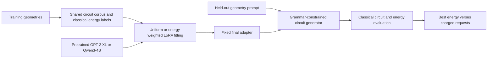

# Energy-Weighted Language Models for Molecular Circuit Search

### A 30-qubit CO₂ case study

**Teo Wei Yew · Xu Zixuan · Chong Bo Yu · Omar Jamoussi**  
SC4055 Quantum Computing · Group 13 · Semester 1, AY 2026/27

**[Written project paper — 13 pages](reports/project_report.pdf)** · **[Comprehensive research report — 51 pages](reports/comprehensive_report.pdf)** · **[Watch the presentation](https://youtu.be/j32O__0uP6M)** · **[Data and results](https://huggingface.co/datasets/bruhrelax/gqe-co2-30q-research-v1)**

## Overview

Can a language model learn from previously evaluated quantum circuits and propose useful circuits for an unseen molecular geometry? We investigate this question using **offline, energy-weighted low-rank adaptation (LoRA)** of GPT-2 XL and Qwen3-4B for molecular ground-state search. Our generative quantum eigensolver (GQE) learns a distribution over discrete circuit descriptions; a separate physics evaluator measures the energy of each proposed circuit.

The study uses linear CO₂ in the full STO-3G basis, corresponding to **30 qubits and 22 electrons**. Three adapters share one accepted training corpus, and eight methods are compared on two held-out bond lengths under fixed energy-request budgets. All energies are computed by classical simulation in a symmetry-restricted space. The experiment is a controlled molecular case study, with one pipeline seed.

**Main finding:** adaptation substantially improves both frozen language models, but the final learned results remain close to a simple training-circuit retrieval baseline. The evidence supports learning a useful proposal distribution; it does not establish quantum advantage or a general advantage over retrieval or VQE.

## Research questions and approach

We examine whether adaptation improves pretrained circuit generators, whether energy weighting helps beyond uniform fitting, and how the resulting search compares with random sampling, circuit retrieval and a compact variational quantum eigensolver (VQE).



The model produces a **32-operation circuit** from a screened excitation catalogue. Grammar constraints enforce valid circuit descriptions. Training minimizes complete-answer negative log-likelihood, with either uniform example weights or weights favouring lower-energy training circuits. At evaluation time, the adapter is fixed: target energies are recorded for scoring and incumbent selection, and are **not fed back into the generator**.

VQE provides a complementary baseline: it uses target-energy feedback to optimize a fixed, continuous 24-parameter fermionic ansatz. The learned and VQE methods have different circuit families, so this comparison measures performance under a common request budget rather than isolating the optimizer alone.

## Experimental design

| Component | Study setting |
| --- | --- |
| Molecular system | Symmetric linear CO₂; STO-3G; 15 spatial orbitals, 30 spin orbitals/qubits, 22 electrons; no frozen core or qubit tapering |
| Classical evaluator | Fixed spin populations, 11 α and 11 β electrons; 1,863,225 determinants; comparison with converged full-configuration-interaction reference energies |
| Training bond lengths | 1.00, 1.20 and 1.32 Å |
| Validation bond length | 1.25 Å |
| Held-out interpolation targets | 1.10 and 1.30 Å |
| Shared accepted corpus | 6,144 fitting circuits and 384 separate diagnostic circuits; diagnostics excluded from fitting |
| Three fixed-budget fits | GPT-2 XL uniform LoRA, GPT-2 XL weighted LoRA, Qwen3-4B weighted LoRA; five passes and 1,920 optimizer steps each |
| Eight evaluation methods | Two frozen models, three adapted models, uniform random sampling, training-circuit retrieval and compact VQE |
| Main budget | Up to 1,024 charged energy requests per method and target, including Hartree–Fock initialization; duplicates and cache hits count |
| Replication | Pipeline seed 22; eight methods × two targets = 16 completed trajectories |

The workflow separates training, validation and final targets, records registrations and checksums, and retains rejected acquisition and failed execution costs. Corpus acquisition, fitting, validation and target evaluation are reported separately rather than treating offline preparation as free.

## Results

Endpoint errors relative to the converged reference are shown in **millihartree (mHa; lower is better)**. Each entry is the best energy observed within its trajectory's request budget. The mean is descriptive across the two targets, not an estimate over independent training seeds.

| Method | 1.10 Å | 1.30 Å | Mean error |
| --- | ---: | ---: | ---: |
| GPT-2 XL, frozen | 177.838 | 245.360 | 211.599 |
| GPT-2 XL, weighted LoRA | 87.488 | 123.765 | 105.626 |
| GPT-2 XL, uniform LoRA | 87.494 | 125.063 | 106.278 |
| Qwen3-4B, frozen | 190.464 | 260.708 | 225.586 |
| Qwen3-4B, weighted LoRA | 86.633 | 123.765 | **105.199** |
| Uniform random sampling | 180.631 | 228.058 | 204.344 |
| Training-circuit retrieval | 87.255 | **123.582** | 105.419 |
| Compact VQE | **85.178** | 130.112 | 107.645 |

Bold marks the lowest value in each column. VQE used 1,023 requests per target, leaving one request unused because its next update required a complete query block. Other methods used 1,024.

- **Adaptation matters in this setting.** Mean endpoint error fell by 105.97 mHa for GPT-2 XL and 120.39 mHa for Qwen3-4B relative to their frozen controls.
- **The weighting-specific gain is modest.** Weighted GPT-2 XL improved on uniform fitting by 0.65 mHa on average. There is no Qwen uniform-fit control.
- **Retrieval is a strong baseline.** Weighted Qwen had the lowest mean error, only 0.220 mHa below retrieval, with the ordering reversing across targets. This does not establish a practical advantage over retrieval.
- **No method dominates both targets.** Compact VQE won at 1.10 Å and retrieval at 1.30 Å. No method reached chemical accuracy against the reference.

These values come from the [released endpoint table](https://huggingface.co/datasets/bruhrelax/gqe-co2-30q-research-v1/blob/064e24614a9092cac48b75e735693391b2b30c29/large_qubit/analysis/section11_v1/tables/method_rows.csv). The reports contain query-efficiency curves, proposal diagnostics, circuit analysis and resource accounting. Across development, both corpus campaigns, validation and main execution, the accounting records **31,452 ordinary energy requests**, including failed attempts.

### Scope and limitations

This is one molecule, one basis, one pipeline seed and two interpolation targets. It provides no evidence of seed robustness, extrapolation or transfer across molecules. The 30-qubit representation is simulated efficiently within a smaller symmetry sector; neither quantum hardware performance nor quantum computational advantage was demonstrated. Different circuit families and offline preparation costs also limit causal comparisons between GQE and VQE. Without a model trained from scratch, the study cannot isolate the benefit of language pretraining itself.

## Papers and presentation

| Resource | Contents |
| --- | --- |
| [Written project paper (PDF, 13 pages)](reports/project_report.pdf) | The group's supplied SC4055 paper, covering motivation, methods, results and discussion |
| [Comprehensive research report (PDF, 51 pages)](reports/comprehensive_report.pdf) | Extended methods, historical development, validation evidence, detailed results, diagnostics and resource accounting |
| [YouTube presentation](https://youtu.be/j32O__0uP6M) | The group's recorded project presentation |

The PDFs are preserved as supplied. The comprehensive report is also archived in the pinned Hugging Face release; the written project paper was added separately to this GitHub repository. File identities and report provenance are recorded in [source_manifest.json](source_manifest.json).

## Code, data and trained adapters

GitHub contains the selected research implementation, tests, launch scripts, small scientific definitions and both PDFs. Hugging Face holds the curated data, saved results and final adapters.

| Resource | Contents | Pinned revision |
| --- | --- | --- |
| [Research dataset and evidence](https://huggingface.co/datasets/bruhrelax/gqe-co2-30q-research-v1) | Accepted corpus, diagnostics, scientific inputs, evaluation ledgers, analyses, resource accounting, reports, research plan and frozen source snapshot | [`064e246`](https://huggingface.co/datasets/bruhrelax/gqe-co2-30q-research-v1/tree/064e24614a9092cac48b75e735693391b2b30c29) |
| [GPT-2 XL uniform LoRA](https://huggingface.co/bruhrelax/gqe-co2-gpt2-xl-uniform-lora) | Final uniform-objective adapter and provenance; 78.7 MB | [`c4b6628`](https://huggingface.co/bruhrelax/gqe-co2-gpt2-xl-uniform-lora/tree/c4b6628e441f7c54a3ca45e2131baf14d1a5afd9) |
| [GPT-2 XL weighted LoRA](https://huggingface.co/bruhrelax/gqe-co2-gpt2-xl-weighted-lora) | Final energy-weighted adapter and provenance; 78.7 MB | [`4a31773`](https://huggingface.co/bruhrelax/gqe-co2-gpt2-xl-weighted-lora/tree/4a3177335f3c01982c4fbd906f841a3bbed5b407) |
| [Qwen3-4B weighted LoRA](https://huggingface.co/bruhrelax/gqe-co2-qwen3-4b-weighted-lora) | Final energy-weighted adapter and provenance; 132.2 MB | [`9da201b`](https://huggingface.co/bruhrelax/gqe-co2-qwen3-4b-weighted-lora/tree/9da201ba59110700426b539a4dff6d3788c33037) |

The model releases contain **LoRA adapters, not full pretrained or merged weights**. Use the model-card loading instructions with the exact upstream bases:

| Adapter family | Required pretrained base | Base revision |
| --- | --- | --- |
| GPT-2 XL | [openai-community/gpt2-xl](https://huggingface.co/openai-community/gpt2-xl) | [`15ea56dee5df4983c59b2538573817e1667135e2`](https://huggingface.co/openai-community/gpt2-xl/tree/15ea56dee5df4983c59b2538573817e1667135e2) |
| Qwen3-4B | [Qwen/Qwen3-4B](https://huggingface.co/Qwen/Qwen3-4B) | [`1cfa9a7208912126459214e8b04321603b3df60c`](https://huggingface.co/Qwen/Qwen3-4B/tree/1cfa9a7208912126459214e8b04321603b3df60c) |

Circuit generation additionally requires the study's prompts, catalogue and grammar constraints. The dataset's [reproduction guide](https://huggingface.co/datasets/bruhrelax/gqe-co2-30q-research-v1/blob/064e24614a9092cac48b75e735693391b2b30c29/REPRODUCE.md) describes the portable release.

## Reproduce the saved results

**Saved-result reanalysis runs locally on a CPU.** It verifies released data and reconstructs the reported tables without training a model or evaluating new circuits.

Download the **complete pinned dataset snapshot** into a separate directory:

```bash
python -m pip install huggingface-hub==0.36.2
hf download bruhrelax/gqe-co2-30q-research-v1 --repo-type dataset --revision 064e24614a9092cac48b75e735693391b2b30c29 --local-dir .research_data/co2-release
python -I -S .research_data/co2-release/release_tools/release_runtime.py reanalyse
```

The standard-library reanalysis requires Python 3.10 or newer. It checks the complete inventory and fitting/diagnostic separation, then reconstructs the saved result and resource tables. Downloading only selected files fails the inventory check.

For ledger-chain and proposal-distribution checks, use **Python 3.12 or newer**:

```bash
python -m pip install numpy==2.5.4
python -I .research_data/co2-release/release_tools/release_runtime.py reanalyse --proposals
```

A fresh-download audit on **16 November 2026** verified the published source and all 538 dataset files in a separate Python 3.12 environment. Both reanalysis modes reproduced the saved results for all 16 trajectories. This checks the recorded experiment; it does not guarantee identical results from a new stochastic run.

### Reproduction boundary

The curated GitHub and Hugging Face release supports **saved-result reproduction**. Original end-to-end training and evaluation launchers also authenticate predecessor preparation records, archived registrations and source chains, token caches, runtime bindings and checkpoint state retained in the full research workspace. Those inputs are not all included in this release. Exported adapters cannot replace optimizer and RNG state for training continuation. Rebuilding the original PDFs likewise requires additional manuscript and historical figure inputs; the finished PDFs are provided here.

## Repository structure

| Path | Purpose |
| --- | --- |
| [`large_qubit/`](large_qubit/) | Physical definitions, circuit grammar, classical energy evaluator, corpus acquisition, LoRA fitting, validation, main evaluation and analysis |
| [`large_qubit/tests/`](large_qubit/tests/) | Unit tests and isolated protocol fixtures |
| [`large_qubit/scripts/`](large_qubit/scripts/) | Original detached tmux launchers for the GPU-server workflow |
| [`large_qubit/catalogues/co2_screened_v1.json`](large_qubit/catalogues/co2_screened_v1.json) | Screened operation catalogue |
| `large_qubit/requirements-*.txt` | Separate recorded analysis, chemistry and model environments |
| [`reports/`](reports/) | Written project paper and comprehensive report |
| `phase3/`, `phase6/`, `tools/` | Selected small modules reused by the current implementation |
| [`source_manifest.json`](source_manifest.json) | Published file checksums, report provenance and pinned release identities |

From the repository root, this standard-library smoke check runs **19 isolated fixture tests**:

```bash
python -B -S -m unittest large_qubit.tests.test_section11_analysis large_qubit.tests.test_section11_costs large_qubit.tests.test_section11_package
```

The complete test suite includes numerical and model tests requiring additional dependencies. Chemistry and CUDA model environments are separate; install only the environment required for the operation.

Historical LiH work, intermediate checkpoints, optimizer states, caches and transfer records remain in the preserved local archive. The explicit `.gitignore` allowlist keeps those materials out of this curated repository. Historical scientific registrations and the released scientific source remain unchanged.
